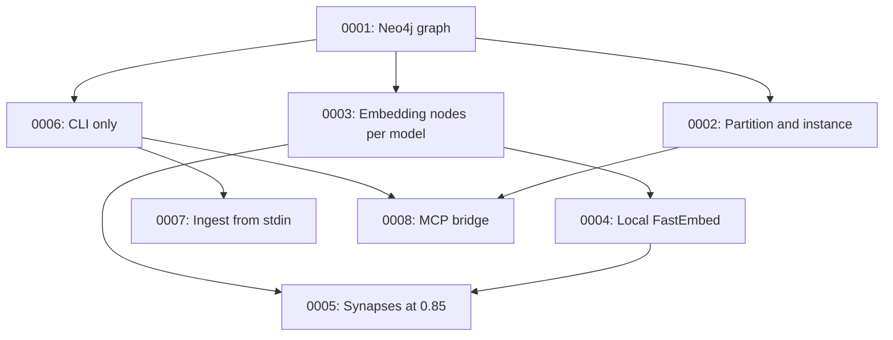

# Architecture Decision Records

This directory holds ADRs for Reservoir: short records of significant architecture decisions,
in Michael Nygard's format, as popularized by Martin Fowler:
<https://martinfowler.com/bliki/ArchitectureDecisionRecord.html>.

Other Sector F Labs projects keep ADRs the same way, for example
[Patina](https://github.com/Sector-F-Labs/patina/tree/main/docs/adr).

## Location

The records live in `adr/`, not `docs/adr/`: `make book` builds the book into `docs/`, and `make clean-book` empties it.

## Backfilled records

ADRs 0001 to 0008 were written afterwards from the Git history and the documentation. Each
dates the decision from the commit where it took effect, and cites commits by short hash. They
describe why the code is the way it is, as far as the history shows it. Where the reasons were
not written down, the Context says what the history suggests. They stay `Proposed` until the
maintainer signs off.

## When to write one

Write an ADR when a decision is:

- Hard, or expensive, to reverse once other code depends on it.
- Not obvious from reading the code: a "why", not a "what".
- The kind of thing that gets re-litigated later without a record.

Small, reversible choices don't need one.

An ADR is a record of a decision as it was made, including the options considered. It is not
rewritten later. A decision that reverses or replaces an earlier one gets a new ADR, and the
old one stays with its status updated.

## Convention

- One file per decision: `NNNN-short-kebab-title.md`, numbered in order, zero-padded to 4
  digits. Numbers are never reused.
- Start from [`0000-template.md`](0000-template.md).
- `Status` is one of `Proposed`, `Accepted`, `Rejected`, `Deprecated` or `Superseded by
  NNNN` (linked).
- Every new ADR gets a row in the index below.
- Keep records short. An ADR records a decision and its reasons; it isn't a design document.

## Index

| # | Title | Status |
|---|-------|--------|
| [0001](0001-store-messages-in-a-neo4j-graph.md) | Store messages in a Neo4j graph | Proposed |
| [0002](0002-partition-and-instance-scope-every-message.md) | Partition and instance scope every message | Proposed |
| [0003](0003-embeddings-as-separate-nodes-per-model.md) | Embeddings as separate nodes, one label and index per model | Proposed |
| [0004](0004-embed-locally-with-fastembed.md) | Embed locally with FastEmbed and BGE-Large | Proposed |
| [0005](0005-synapses-link-similar-messages-above-0-85.md) | Synapses link similar messages above a cosine similarity of 0.85 | Proposed |
| [0006](0006-cli-only-no-proxy.md) | A CLI only: remove the proxy server | Proposed |
| [0007](0007-ingest-from-stdin-with-a-trace-id.md) | Ingest messages from stdin, tagged with an optional trace id | Proposed |
| [0008](0008-mcp-bridge-wraps-the-cli.md) | Expose Reservoir to agents with a Python MCP bridge around the CLI | Proposed |

## Decision Relationship

